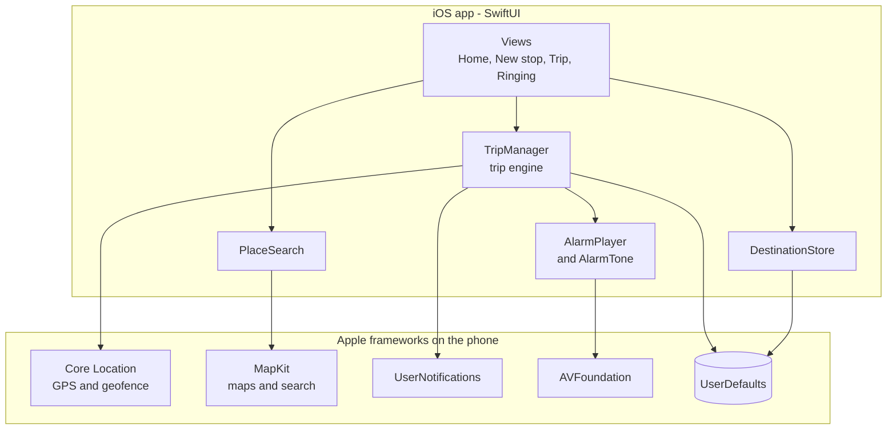
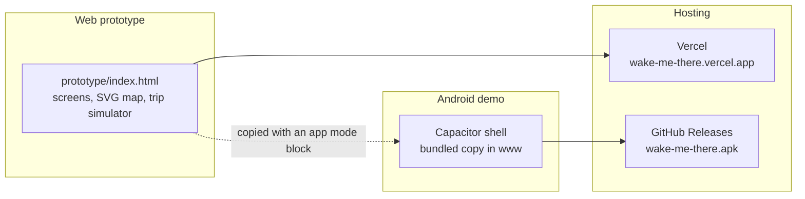
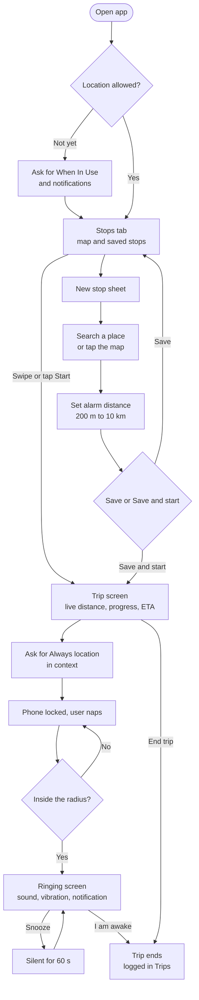
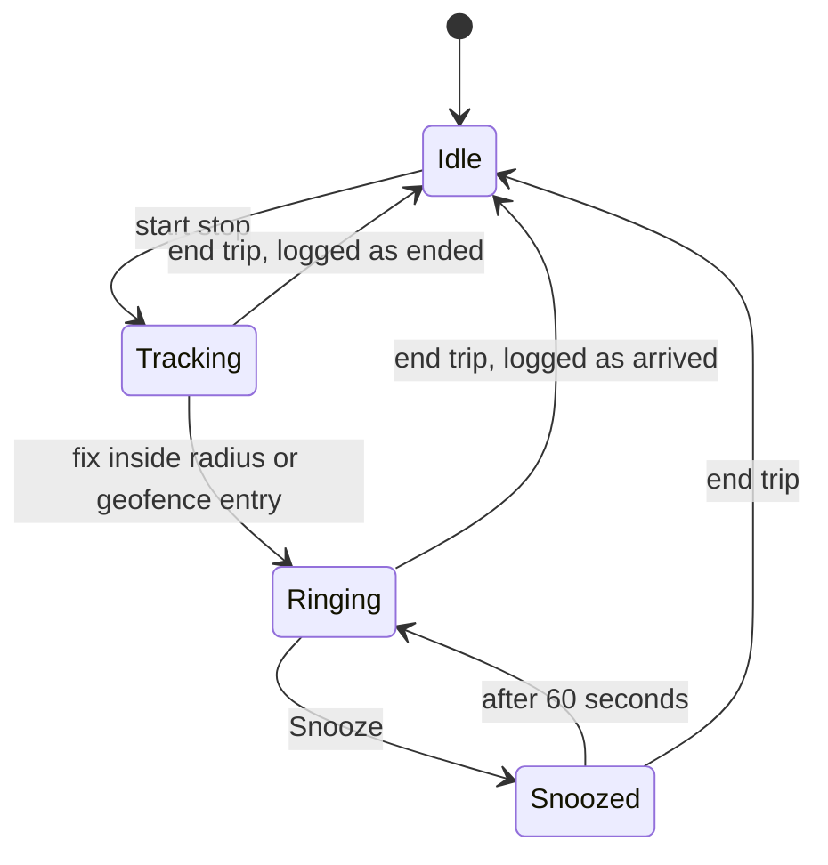
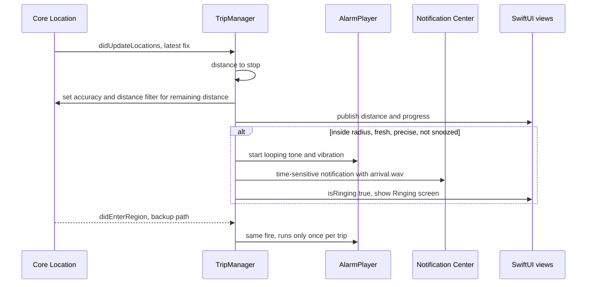
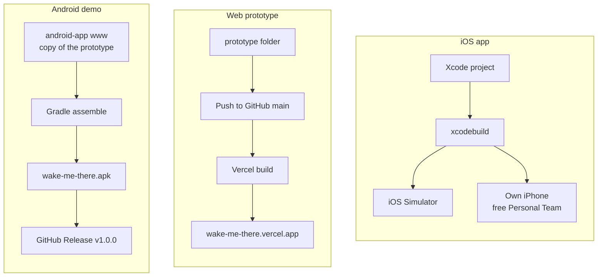

# Wake Me There

Wake Me There is a travel alarm for iPhone. You pick your stop and how close you want to be woken, then nap on the bus or train. The alarm rings as you approach, even with the phone locked or on silent. The engineering idea is reliability in layers: continuous background location does the main work, a geofence stands behind it in case iOS closes the app, and a time-sensitive notification carries a custom alarm sound. There is no server and no account; everything stays on the phone.

| | |
|---|---|
| **Platforms** | iOS 17+ native app; web prototype; Android demo app |
| **Stack** | SwiftUI, Core Location, MapKit, AVFoundation, UserNotifications |
| **Data** | On device only, in UserDefaults; no backend |
| **Hosting** | Prototype on Vercel; APK on GitHub Releases |

## System architecture

The product has three separate builds. The **real app** is native SwiftUI and talks only to Apple frameworks on the phone. The **web prototype** is one HTML file that mirrors the app's screens and logic, with a simulated GPS trip so anyone can try the alarm in a browser. The **Android app** is a Capacitor shell that bundles a copy of that prototype, so it is a demo of the design, not a working location alarm.

_The iOS app talks only to Apple frameworks on the phone. There is no server._

_The prototype and the Android demo share one HTML file._

## Main user flow

The core job is "wake me before my stop". A stop is saved once and can be started again from the list with a swipe.

_"Always" permission is requested only when the first trip starts, where its purpose is obvious._

### Trip states

`TripManager` is a small state machine. These are its states and what moves it between them.

_While snoozed, new fixes and geofence events are ignored so the alarm does not restart early._

## Data flow and state

The key path is a GPS fix arriving while the phone is locked. Core Location calls the delegate; `TripManager` works out the distance, retunes GPS accuracy for battery, checks the fix is trustworthy, and fires the alarm once.

_A fix counts only if it is under 60 seconds old and its accuracy is within the larger of 150 m or the alarm radius._

### GPS accuracy tuning

| Distance left to the alarm edge | Desired accuracy | Distance filter |
|---|---|---|
| More than 20 km | Hundred metres | 300 m |
| 5 to 20 km | Nearest ten metres | 80 m |
| Under 5 km | Best | 15 m |

### Where state lives

| Where | What it holds |
|---|---|
| UserDefaults `savedDestinations` | Saved stops as JSON: name, subtitle, latitude, longitude, radius in metres |
| UserDefaults `tripHistory` | Finished trips, newest first, capped at 50; outcome is arrived or ended |
| UserDefaults `activeTrip` `activeTripStartedAt` | The running trip, so it resumes if iOS relaunches the app for a geofence |
| Core Location | One monitored circular region per active trip, keyed by the stop's id |
| Library, Sounds `arrival.wav` | A generated alarm tone of about 25 seconds, written once at launch for notifications |
| Memory only `lastDeleted` | The last deleted stop, for the Undo toast |

## Key modules

| File / module | Responsibility |
|---|---|
| `WakeMeThereApp.swift` | App entry and AppDelegate. Sets the notification delegate, installs the alarm sound, creates `TripManager` at launch so geofence events after a background relaunch reach it. `RootView` switches between Home and Trip and shows Ringing as a full-screen cover. |
| `Services/TripManager.swift` | The trip engine: permissions, start and end, background location session, geofence, accuracy tuning, fire, 60-second snooze, resume after relaunch. |
| `Services/AlarmPlayer.swift` | Plays a looping tone with the playback audio category so it sounds on silent, plus a vibration every 1.4 s. `AlarmTone` synthesises the WAV in code, so the app ships no audio files. |
| `Services/PlaceSearch.swift` | MapKit autocomplete for addresses and points of interest, biased to a 200 km box around the user, then resolves the chosen result to a coordinate. |
| `Services/DemoMode.swift` | Debug builds only. `-demo` launch arguments load sample Chennai stops and history and open a set state for screenshots and reviews. |
| `Models/Destination.swift` | The stop model and distance and duration formatting. |
| `Models/DestinationStore.swift` | Saved stops and trip history with add, edit, delete, undo and persistence. |
| `Views/` | `HomeView` (Stops and Trips tabs, swipe actions, Undo toast), `AddDestinationView` (search, map tap to drop a pin, distance slider and presets), `TripView` (live map and progress), `RingingView`. |
| `prototype/index.html` | The web prototype: screens, a sample 24 km route drawn in SVG, a trip simulator panel, and the same chirp tone made with Web Audio. |
| `android-app/` | Capacitor 8 project, app id `com.gopinath.wakemethere`, with the prototype copied into `www`. |

## Platforms

### iOS, native

SwiftUI app for iOS 17 and later, bundle id `com.gopinath.WakeMeThere`, portrait only. It declares the `location` and `audio` background modes and two location usage strings. Its look is stock Apple HIG: a `TabView`, large titles, inset-grouped lists and forms, swipe actions, confirmation dialogs and a full-screen alarm. An audit of the HIG components is kept in `AUDIT-HIG.md`. This app is not a web shell, so the Kolam iOS kit does not apply to it.

### Web prototype

A single page with no build step, styled with Kolam tokens (`kolam/tokens.css`, Lato). It draws an iPhone frame around the app screens because its job is to show the iOS design. A side panel stands in for GPS: start a stop on the phone, then choose the travel mode speed, speed the clock up, pause, skip ahead or lock the phone. The simulator reuses the app's rules: the same accuracy tiers, the same fire and snooze logic and a matching chirp pattern. Its state is in memory only and resets on reload.

### Android demo

A bundled Capacitor app: `android-app/www/index.html` is the prototype plus an extra "Android app mode" block that removes the iPhone frame and scales the 360 by 780 app screen to fit the device. Inside the Android app the Kolam M3 kit (`m3/kolam-m3.js` and `.css`) adds `k-android` to the page, so it follows Material 3: a navigation bar, a floating add button, M3 dialogs and chips. The hardware Back button closes a dialog, leaves the stop screen, ends a trip or returns to Stops before exiting. You can preview this look in a browser with `?app=android`. The Android demo uses the simulated trip, not real GPS.

## Data sources and APIs

| Source | Used for | Licence / key |
|---|---|---|
| Core Location | Live position, background updates, region monitoring | Apple framework, no key |
| MapKit | Maps, alarm-zone circles, place autocomplete and lookup | Apple framework, no key |
| UserNotifications | Time-sensitive arrival notification | Apple framework, no key |
| Prototype sample data | Seven Chennai places on one Tambaram to Chennai Central route | Written by hand in the page; the map is drawn in SVG, no map service |

## Offline, performance, privacy and accessibility

**Offline.** Tracking and the alarm need no network. Place search and map tiles use MapKit, which needs a connection when you add a stop.

**Battery.** GPS precision drops when far from the stop and sharpens close to it (see the table above). Background updates are only on during a trip and are switched off when it ends.

**Reliability.** Stale or imprecise fixes are ignored to avoid false alarms. The geofence is a second trigger, and with "Always" permission iOS relaunches the app on entry. The alarm audio uses the playback category so it ignores the silent switch.

**Privacy.** There is no server, account or analytics in the code. Location is used on the phone and never sent anywhere by the app; stops and history stay in UserDefaults.

**Accessibility.** The HIG audit records Dynamic Type, VoiceOver labels and values (for example the distance slider reads its value), Reduce Motion and contrast fixes. The prototype gives its swipe rows keyboard support (Enter to open, Delete to remove) and ARIA roles on tabs and chips.

## Build and deploy

_The iOS app is not on the App Store; it is built and installed from Xcode._

The Vercel project (`wake-me-there`, linked from `prototype/.vercel`) serves the `prototype` folder, and the commit "Vercel: ignore local link files; deploy from GitHub" switched it to deploy from pushes to `main`. The Android APK is built locally from `android-app` and uploaded to the `v1.0.0` release. Builds signed with a free team expire after seven days on a device.

## Known limits and next steps

- Distance is a straight line to the stop, not distance along the route, so a winding route can ring a little early.
- The alarm rings through the app's own audio session and a notification; it is not a system alarm, so Focus modes can still affect the notification. AlarmKit (iOS 26) is listed as a next step in the README.
- Snooze is a fixed 60 seconds and re-rings at the same radius.
- One alarm tone only; no Live Activity or Dynamic Island yet.
- The Android app and web prototype are demos with a simulated trip; there is no real Android location alarm.

---

Written from the source code on 17 November 2026. Source: github.com/tgopinath/WakeMeThere
